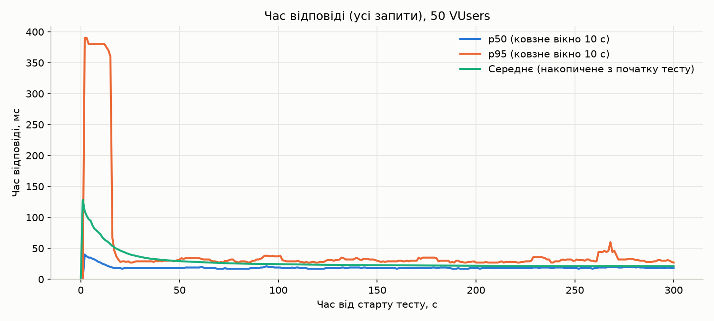
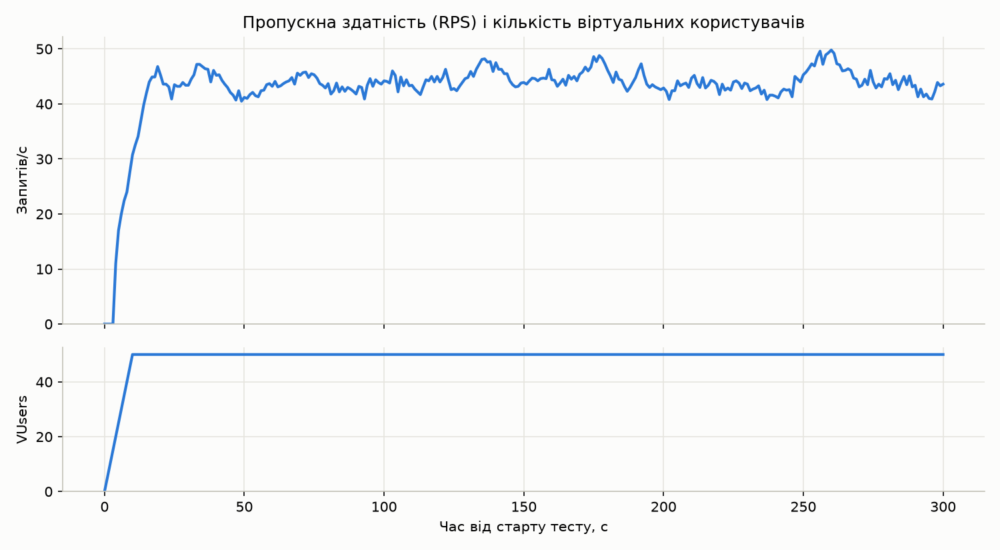
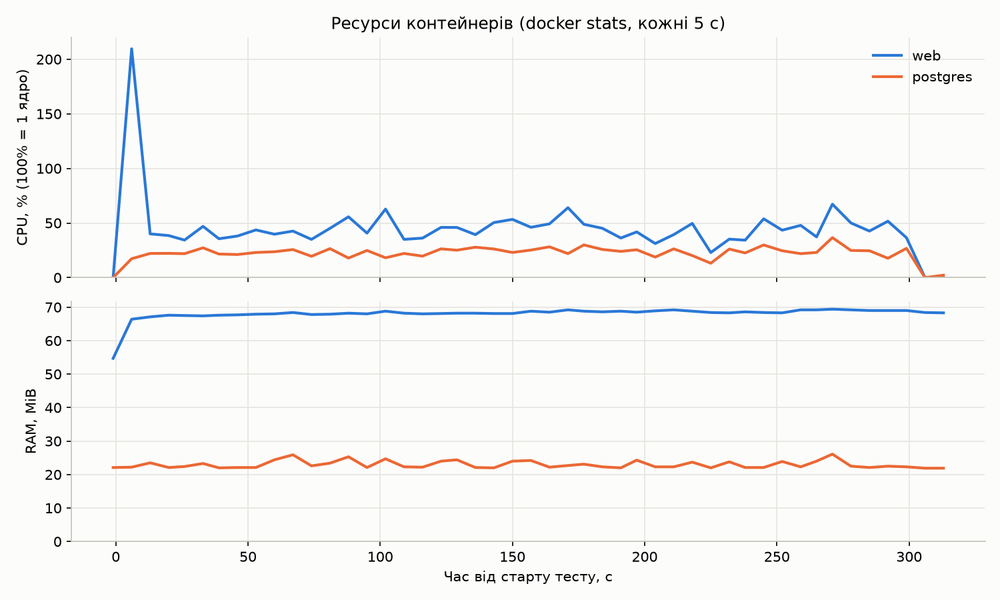

# Лабораторна робота №4 — Первинне навантажувальне тестування

## 1. Інструмент

**Locust 2.46** (Python). Сценарій — звичайний Python-клас, тому лягає в той
самий стек, що й проєкт, і не потребує нічого, крім `pip install locust`.
Locust сам веде сесію (cookies), тож CSRF-токен і `sessionid` після логіну
працюють так само, як у браузері.

Файли:

| Файл | Призначення |
|---|---|
| `locust/locustfile.py` | сценарій користувача |
| `locust/monitor_resources.py` | `docker stats` кожні 5 с → `locust/results/resources.csv` |
| `locust/plot_results.py` | графіки з CSV → `docs/images/lab4_*.png` |
| `locust/requirements.txt` | `locust`, `matplotlib` (окремо від `requirements.txt` застосунку, щоб не тягнути їх у Docker-образ і CI) |
| `locust/results/` | сирі результати контрольного запуску (`run1_*.csv`, `resources.csv`) |

## 2. Сценарій

Клас `AuctionVisitor(HttpUser)`:

- `on_start` — один раз на віртуального користувача: `GET /accounts/login/`
  (отримати `csrftoken`), `POST /accounts/login/` випадковим seed-користувачем
  (`pilot1`, `pilot2`, `starcommander`, `voidtrader`), потім `GET /lots/`, звідки
  беруться id реально існуючих лотів. Логін вважається невдалим, якщо після
  редиректу користувач не на `/dashboard/user/`, бо інакше всі
  `@login_required`-сторінки «успішно» віддавали б 200 з формою логіну.
- Далі в циклі з паузою `between(1, 3)` с — задачі за вагами:

| Задача | Вага | Запити |
|---|---|---|
| головна | 2 | `GET /` |
| список лотів | 3 | `GET /lots/` |
| деталі лотів | 4 | 3 × `GET /lots/<id>/` (випадкові існуючі id) |
| дашборд | 1 | `GET /dashboard/user/` |

**Відхилення від завдання:**

- `GET /inventory/` у проєкті не існує (немає ні маршруту, ні view, ні моделі
  інвентарю), тому до сценарію не входить. Найближчий аналог — особистий
  дашборд `/dashboard/user/`, він у сценарії є.
- **WebSocket не тестувався.** Ставки йдуть через `/ws/auction/<id>/`, а Locust
  нативно WebSocket не підтримує. JS на сторінці лота, що відкриває сокет,
  Locust не виконує. Тож логіка `place_bid()` з `select_for_update` (головне
  місце конкуренції за блокування в БД) цим тестом **не навантажена**. Для неї
  потрібен окремий тест: Locust з власним WS-клієнтом або k6/`websockets`.

## 3. Профіль навантаження і середовище

| Параметр | Значення |
|---|---|
| VUsers | **50** |
| Spawn rate (ramp-up) | **5 користувачів/с** (усі 50 за 10 с) |
| Тривалість | **5 хв** |
| Модель | закрита (кожен VUser чекає відповідь, потім паузу 1–3 с) |
| Ціль | **sandbox** (`docker compose up --build`, `DJANGO_ENV=sandbox`), `http://127.0.0.1:8000` |

Команда (з ЛР-завдання + `--csv-full-history`, щоб у `run1_stats_history.csv`
були перцентилі за ковзне вікно 10 с, а не накопичені з початку тесту, — без
цього графік часу відповіді не показує динаміки):

```bash
pip install -r locust/requirements.txt
docker compose up --build -d          # sandbox

python locust/monitor_resources.py --duration 320 \
    galactic-auction-sandbox-web-1 galactic-auction-sandbox-postgres-1 &
locust -f locust/locustfile.py --host http://127.0.0.1:8000 \
    --users 50 --spawn-rate 5 --run-time 5m --headless \
    --csv=locust/results/run1 --csv-full-history
python locust/plot_results.py
```

Стенд: MacBook (macOS, 10 CPU), Docker Desktop (10 CPU / 7.75 GiB для VM),
Django 6.1.1, один процес `daphne`, PostgreSQL 16, Redis 7. Locust працював
на тій самій машині, що й стек.

## 4. Результати

### Підсумкова таблиця

| Метрика | Значення |
|---|---|
| Усього запитів | 13 175 |
| **RPS** (середнє за весь тест) | **44.0** (на плато після ramp-up: 44.2, діапазон 40.5–49.8) |
| **Latency avg** | **21.4 мс** |
| **Latency min** | **11.3 мс** |
| **Latency max** | **457 мс** (`POST /accounts/login/`) |
| Latency median | 18 мс |
| **Latency p95** | **32 мс** |
| Latency p99 | 46 мс |
| **Error Rate** | **0 %** (0 failures, 0 exceptions) |
| **CPU peak, web** | **209.6 %** (на ramp-up, під час логінів); плато: середнє 43.7 %, макс. 67.2 % |
| CPU peak, postgres | 36.6 % (плато: середнє 23.8 %) |
| **RAM peak, web** | **69.4 MiB** (54.7 MiB у простої) |
| RAM peak, postgres | 26.1 MiB |

CPU у `docker stats` рахується від одного ядра: 100 % = 1 повне ядро.

### По ендпоінтах (з `run1_stats.csv`)

| Ендпоінт | Запитів | Avg, мс | Median | p95 | Max | RPS | Помилки |
|---|---:|---:|---:|---:|---:|---:|---:|
| `GET /` | 1 468 | 19.9 | 19 | 30 | 114 | 4.90 | 0 |
| `GET /accounts/login/` | 50 | 43.6 | 37 | 110 | 114 | 0.17 | 0 |
| `POST /accounts/login/` | 50 | **379.3** | 380 | 410 | 457 | 0.17 | 0 |
| `GET /dashboard/user/` | 730 | 20.6 | 19 | 33 | 131 | 2.44 | 0 |
| `GET /lots/` | 2 237 | 23.7 | 21 | **38** | 181 | 7.47 | 0 |
| `GET /lots/<id>/` | 8 640 | 18.8 | 17 | 29 | 279 | 28.84 | 0 |
| **Aggregated** | **13 175** | **21.4** | **18** | **32** | **457** | **43.97** | **0** |

### Графіки

Час відповіді в часі (p50/p95 — ковзне вікно 10 с):



RPS і кількість VUsers у часі:



CPU і RAM контейнерів `web` і `postgres`:



## 5. Виявлені вузькі місця

**Загальний висновок:** на 50 VUsers система не насичена. Помилок 0, p95
тримається в межах 27–60 мс на всьому плато, RPS не просідає, пам'ять
стабільна (немає ознак витоку). Нижче перелічено те, що видно в цифрах, і
те, що обмежить систему при більшому навантаженні.

1. **RPS обмежений сценарієм, а не сервером.** Одна ітерація в середньому
   робить (2·1 + 3·1 + 4·3 + 1·1) / 10 = 1.8 запиту, пауза між ітераціями —
   у середньому 2 с. Отже 50 × 1.8 / ~2.05 с ≈ **44 RPS**, що точно збігається
   з виміряним. Сервер встигав відповідати за ~20 мс, тому пропускна
   здатність дорівнювала тому, що генерувала закрита модель. **Стелю цей
   тест не знайшов.** Для цього потрібен ступінчастий тест (100 → 200 → 400
   VUsers або `wait_time` близько 0), щоб побачити точку, де p95 починає рости,
   а RPS перестає.

2. **`POST /accounts/login/` — найповільніший ендпоінт: ~380 мс, у 18–20 разів
   довше за решту.** Причина — хешування пароля: Django 6.1 використовує
   PBKDF2 з **1 500 000 ітерацій** (це CPU-bound робота). Саме логіни дають
   **пік CPU web 209.6 %** і p95 ≈ 390 мс у перші ~15 с, коли 5 нових
   користувачів/с логіняться одночасно. Після ramp-up p95 падає до ~30 мс.
   Це свідома ціна безпеки, тож зменшувати кількість ітерацій не варто. Але
   «шторм логінів» (масовий вхід після рестарту, brute-force) першим з'їсть
   CPU. Захист: rate-limit на логін, довгоживучі сесії.

3. **N+1 запит у `/lots/`.** Шаблон `lot_list.html` для кожного лота читає
   `lot.owner.username`, а view робить `Lot.objects.all()` без
   `select_related("owner")`. Тому на сторінку виходить 1 + N запитів до БД.
   Зараз лотів 8, і `/lots/` уже найповільніший GET: p95 38 мс проти 29–33 мс
   у решти, max 181 мс. Сторінка ще й без пагінації, тож затримка ростиме
   лінійно з кількістю лотів. Виправлення — `select_related("owner")` і
   пагінація.

4. **Гіпотеза про `select_for_update` на `/lots/<id>/` не підтвердилась.**
   `lot_detail` робить звичайний `get_object_or_404(Lot, pk=pk)` без
   блокувань. `select_for_update` є лише в `services.place_bid()`, тобто у
   ставках через WebSocket/API, які цей тест не викликає. `/lots/<id>/` —
   навпаки найшвидший ендпоінт (avg 18.8 мс, p95 29 мс), хоч і отримав 65 %
   усіх запитів. Конкуренцію за блокування рядка `Lot` треба міряти окремим
   тестом ставок.

5. **Один процес `daphne` — майбутня стеля по CPU.** На плато web використовує
   в середньому ~0.44 ядра на 44 RPS, тобто ≈ 10 мс CPU на запит. Python-код
   у одному процесі впирається в GIL (≈ 1 ядро). Груба оцінка стелі одного
   процесу — **~100 RPS** для такого міксу запитів, решта 9 ядер простоюють.
   PBKDF2 вміє виходити за 100 % (звідси 209 %), бо `hashlib` відпускає GIL,
   а рендеринг шаблонів і ORM — ні. Масштабування: кілька процесів
   (`uvicorn --workers N` або кілька реплік `web` за балансувальником).
   Оцінку треба підтвердити ступінчастим тестом із п. 1.

6. **Вага сторінки ~24–26 KB на кожен запит.** Із них ~23 KB — це inline CSS і
   JS (зоряне небо) з `base.html`, які повторюються в кожній відповіді й не
   кешуються браузером. На 44 RPS це ~1.1 MB/с вихідного трафіку майже
   однакового вмісту. Якщо винести їх у статичні файли з кешуванням,
   HTML-відповідь стане в кілька разів легшою.

7. **Поодинокий сплеск p95 до 60 мс на ~268 с** збігається з максимумом CPU
   web на плато (67 % на 271 с). Це короткочасна черга в одному процесі
   `daphne` (див. п. 5), яка розсмокталась за кілька секунд. RPS при цьому
   не впав, помилок не було.

### Обмеження тесту

- Sandbox запущений з `DEBUG=True`: Django зберігає кожен SQL-запит у
  `connection.queries`, а це зайва робота на кожному запиті. У production
  цифри мають бути трохи кращими.
- Locust і стек працюють на одному ноутбуці (Docker Desktop VM), тож мережа —
  loopback, і генератор навантаження конкурує із сервером за CPU.
- Тільки HTTP-частина. WebSocket-ставки й Redis channel layer не навантажені.
- Один прогін на 50 VUsers. Точку насичення не визначено (див. п. 1).
