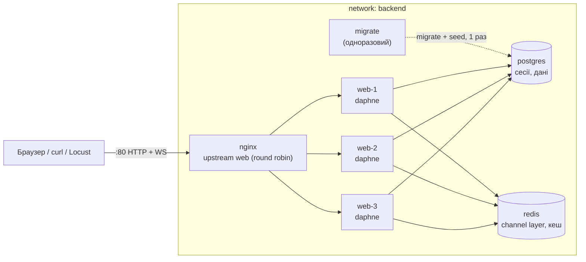
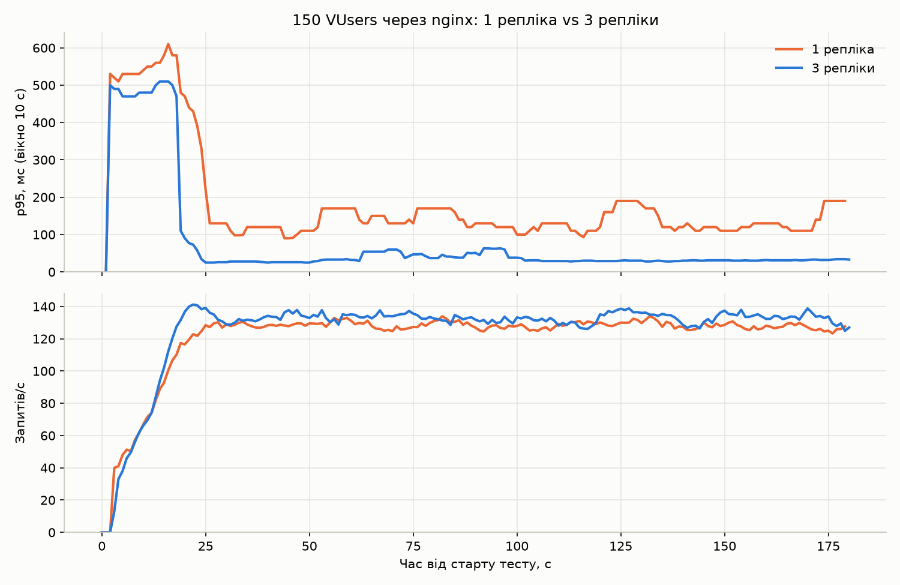
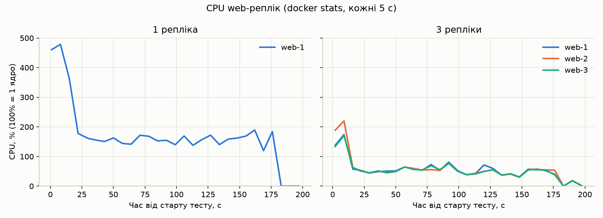

# ЛР №6 — Балансування навантаження за допомогою Nginx

Стенд: MacBook Pro, Apple M1 Pro (10 ядер, 16 GB RAM); Docker Desktop має
**10 CPU і 7.75 GiB RAM** (`docker info`). Nginx 1.28.3, Docker Compose v5.2.
Усі результати нижче отримані на цьому ж ноутбуці.

## 1. Архітектура



- **Репліки** — `deploy.replicas: 3` у сервісі `web` (Compose v5 це підтримує;
  `--scale web=N` перекриває кількість). Порту на хості в `web` немає: три
  контейнери не можуть зайняти один порт, назовні виходить тільки `nginx :80`.
- **Міграції один раз.** `entrypoint.sh` у проєкті немає: міграції й `seed` вже
  виконує окремий сервіс `migrate`, а репліки чекають на нього через
  `condition: service_completed_successfully`. У `docker compose logs migrate`
  блок `Operations to perform` з'являється 1 раз; `migrate-1 Exited (0)`.
- **Репліки без стану.** Сесії Django зберігаються в БД (`SESSION_ENGINE` не
  змінений, тобто `django.contrib.sessions.backends.db`), WebSocket-групи —
  у спільному Redis channel layer, `SECRET_KEY` однаковий (той самий `env_file`).
  Тому sticky sessions не потрібні: будь-яка репліка обслуговує будь-який запит.
- **Ідентифікація сервера.** `GET /api/whoami/` → `{"hostname": "<container id>"}`
  (`socket.gethostname()`, публічний, без БД), і middleware
  `auctions.middleware.served_by_middleware` додає `X-Served-By` до кожної відповіді.
  Тести: `src/auctions/tests/test_whoami.py` (без фікстури `db`, тож будь-який
  запит до БД провалив би тест).

## 2. Конфігурація nginx (`nginx/nginx.conf`)

Каталог `./nginx` змонтовано як `/etc/nginx/conf.d` (http-контекст стандартного
`nginx.conf`); правки підхоплюються через `docker compose exec nginx nginx -s reload`.

```nginx
map $http_upgrade $connection_upgrade {      # Connection: upgrade лише для WS-запитів
    default upgrade;
    ''      close;
}
log_format upstream '$remote_addr "$request" $status upstream=$upstream_addr rt=$request_time';

upstream web {
    zone web 64k;                                   # спільні лічильники помилок для воркерів
    server web:8000 max_fails=1 fail_timeout=10s;   # без директиви алгоритму = round robin
}

server {
    listen 80;
    access_log /var/log/nginx/access.log upstream;  # у лозі видно, яка репліка відповіла

    proxy_next_upstream error timeout http_502 http_503 http_504;
    proxy_next_upstream_tries 3;
    proxy_connect_timeout 1s;

    location / {
        proxy_pass http://web;
        proxy_set_header Host $host;
        proxy_set_header X-Real-IP $remote_addr;
        proxy_set_header X-Forwarded-For $proxy_add_x_forwarded_for;
        proxy_set_header X-Forwarded-Proto $scheme;
    }
    location /ws/ {
        proxy_pass http://web;
        proxy_http_version 1.1;                       # Upgrade можливий лише в HTTP/1.1
        proxy_set_header Upgrade $http_upgrade;
        proxy_set_header Connection $connection_upgrade;
        proxy_set_header Host $host;                  # proxy_set_header не успадковується,
        proxy_set_header X-Real-IP $remote_addr;      # якщо location задає власні —
        proxy_set_header X-Forwarded-For $proxy_add_x_forwarded_for;   # тому повторено
        proxy_set_header X-Forwarded-Proto $scheme;
        proxy_read_timeout 1h;                        # відкрита сторінка лоту тримає сокет
        proxy_send_timeout 1h;
    }
}
```

### Як nginx знаходить репліки: DNS-ім'я сервісу, а не web1/web2/web3

Вбудований DNS Docker повертає для імені `web` по одному A-запису на кожну
запущену репліку; nginx при старті перетворює `server web:8000` на 3 peer'и.
Явні `web1/web2/web3` вимагали б трьох окремих сервісів замість `replicas`.

Перевірено два варіанти:

| Варіант | Що робить | Результат (8 зупинок репліки × 40 запитів) |
|---|---|---|
| `server web:8000 resolve` + `resolver 127.0.0.11 valid=5s` | перерезолвлює ім'я кожні 5 с | **2 запити з 320 → 502** (`no live upstreams`): повтор після таймауту збігся з оновленням списку peer'ів |
| `server web:8000` (резолв при старті) — **обрано** | статичний список із 3 IP | **0 помилок з 320** |

Зупинена й знову запущена репліка зберігає свою IP-адресу, тому сама
повертається в ротацію. Обмеження обраного варіанту: після зміни кількості
реплік (`--scale`) або перестворення `web` треба `docker compose restart nginx`
(`depends_on: restart: true` перевірено: Compose не перезапускає nginx ні на
`--scale`, ні на `--force-recreate web`, тому від нього відмовились).

### ALLOWED_HOSTS і CSRF через http://localhost

nginx передає `Host: localhost`, який уже є в `ALLOWED_HOSTS` обох середовищ.
Django 4+ порівнює заголовок `Origin` з `request.get_host()`; для
`Origin: http://localhost` і `Host: localhost` вони збігаються, тож
`CSRF_TRUSTED_ORIGINS` **не потрібен**. Перевірено:

```
sandbox:    POST /accounts/login/ (Origin: http://localhost)   -> 302 на /dashboard/user/
production: POST /accounts/login/ (невірний пароль, CSRF ok)   -> 401 (невірні дані, а не 403 CSRF)
production: POST без токена, Origin: http://evil.example       -> 403
production: WebSocket ws://localhost/ws/auction/1/             -> handshake ok
```

## 3. Round Robin: 20 послідовних запитів

```bash
for i in $(seq 1 20); do curl -s http://localhost/api/whoami/; echo; done
```

| # | HTTP | X-Served-By | репліка |
|---|---|---|---|
| 1 | 200 | af9564f730cb | web-2 |
| 2 | 200 | 2d74f2a35464 | web-1 |
| 3 | 200 | 09ac40ac36aa | web-3 |
| 4 | 200 | af9564f730cb | web-2 |
| 5 | 200 | 2d74f2a35464 | web-1 |
| 6 | 200 | 09ac40ac36aa | web-3 |
| 7 | 200 | af9564f730cb | web-2 |
| 8 | 200 | 2d74f2a35464 | web-1 |
| 9 | 200 | 09ac40ac36aa | web-3 |
| 10 | 200 | af9564f730cb | web-2 |
| 11 | 200 | 2d74f2a35464 | web-1 |
| 12 | 200 | 09ac40ac36aa | web-3 |
| 13 | 200 | af9564f730cb | web-2 |
| 14 | 200 | 2d74f2a35464 | web-1 |
| 15 | 200 | 09ac40ac36aa | web-3 |
| 16 | 200 | af9564f730cb | web-2 |
| 17 | 200 | 2d74f2a35464 | web-1 |
| 18 | 200 | 09ac40ac36aa | web-3 |
| 19 | 200 | af9564f730cb | web-2 |
| 20 | 200 | 2d74f2a35464 | web-1 |

Строге чергування web-2 → web-1 → web-3 (7/7/6 запитів).

## 4. WebSocket через nginx і різні репліки

`python scripts/ws_cross_replica_check.py`: два користувачі логіняться через
форму, pilot1 робить REST-ставку, далі обидва відкривають WebSocket на той самий
лот, і pilot1 робить ставку через сокет.

```
login pilot1: 200 -> http://localhost/dashboard/user/  X-Served-By=297e8da3f9b0
login pilot2: 200 -> http://localhost/dashboard/user/  X-Served-By=297e8da3f9b0
GET /lots/: 200, 8 lots, X-Served-By=60392e64f975
GET /lots/4/: 200, X-Served-By=60392e64f975
REST bid 2503.00 on lot 4: 201, X-Served-By=e43d377e99e1
WebSocket A (pilot1) and B (pilot2) connected
A received: {"type": "bid_accepted", "amount": "2504.00", "user": "pilot1", "new_balance": "7186.00"}
B received: {"type": "bid_accepted", "amount": "2504.00", "user": "pilot1"}

$ docker compose logs web | grep WSCONNECT
web-1  | 172.24.0.7:44124 - - [18/Oct/2026:16:56:10] "WSCONNECT /ws/auction/4/" - -
web-3  | 172.24.0.7:48982 - - [18/Oct/2026:16:56:10] "WSCONNECT /ws/auction/4/" - -
$ docker compose logs nginx | grep /ws/
nginx-1  | 192.168.65.1 "GET /ws/auction/4/ HTTP/1.1" 101 upstream=172.24.0.5:8000   # web-1 (A)
nginx-1  | 192.168.65.1 "GET /ws/auction/4/ HTTP/1.1" 101 upstream=172.24.0.6:8000   # web-3 (B)
```

Сокет A обслуговує web-1, сокет B — web-3. Ставка, прийнята web-1, через
`group_send` у Redis дійшла до web-3 і клієнта B. HTTP-запити того ж сценарію
пройшли через три різні репліки, а сесія (cookie `sessionid`) працювала на кожній.

## 5. Відмовостійкість

Пасивні перевірки (активні `health_check` є лише в nginx Plus):

- `max_fails=1 fail_timeout=10s` — після однієї невдалої спроби з'єднання
  репліка на 10 с виключається з ротації, потім nginx пробує її знову;
- `proxy_next_upstream error timeout http_502 http_503 http_504` +
  `proxy_next_upstream_tries 3` — невдалий запит прозоро повторюється на
  наступній репліці, клієнт помилки не бачить;
- `proxy_connect_timeout 1s` — IP зупиненого контейнера не відповідає взагалі
  (немає RST, лише таймаут), тож без цього кожна така спроба чекала б 60 с.

**Чесні обмеження.** Nginx дізнається про відмову лише на *реальному* запиті:
перший запит після падіння репліки отримує +1 с затримки (таймаут з'єднання),
і так само раз на `fail_timeout`, поки репліка лежить. POST/PATCH (ставки,
логін) **не повторюються** (nginx не повторює неідемпотентні запити без
`non_idempotent`; це навмисно, щоб ставка не пройшла двічі), тож POST, що
потрапив на репліку саме в момент падіння, може отримати 502/504.
Healthcheck у compose (`web`: `GET /` через `urllib`, кожні 10 с) показує стан
у `docker compose ps` і тримає nginx до готовності реплік (`depends_on:
service_healthy`), але nginx його не читає.

Демонстрація: 45 запитів кожні 0.2 с, на 2-й секунді зупинка web-2, на 8-й — запуск.

```
19:40:15 $ docker stop galactic-auction-sandbox-web-2
$ docker compose ps web
NAME                             STATUS
galactic-auction-sandbox-web-1   Up 56 seconds (healthy)
galactic-auction-sandbox-web-2   Exited (0) Less than a second ago
galactic-auction-sandbox-web-3   Up 21 seconds (healthy)
19:40:21 $ docker start galactic-auction-sandbox-web-2
```

| # | HTTP | репліка |
|---|---|---|
| 1–10 | 200 | web-1, web-2, web-3 по колу |
| 11 | 200 | web-3 ← черга web-2: таймаут з'єднання 1 с, nginx повторив запит на web-3 |
| 12 | 200 | web-3 |
| 13–45 | 200 | лише web-1 / web-3 по черзі |

Підсумок: **45 × 200, 0 помилок** (web-1: 21, web-2: 3, web-3: 21). Лог nginx:

```
[warn]  upstream server temporarily disabled while connecting to upstream, upstream: "http://172.24.0.6:8000/api/whoami/"
[error] upstream timed out (110: Operation timed out) while connecting to upstream, upstream: "http://172.24.0.6:8000/api/whoami/"
```

Повернення в ротацію (після `fail_timeout`):

```
NAME                             STATUS
galactic-auction-sandbox-web-1   Up About a minute (healthy)
galactic-auction-sandbox-web-2   Up 9 seconds (healthy)
galactic-auction-sandbox-web-3   Up 37 seconds (healthy)
```

| # | HTTP | X-Served-By | репліка |
|---|---|---|---|
| 1 | 200 | f70de34e9289 | web-3 |
| 2 | 200 | c46c576e08f9 | web-1 |
| 3 | 200 | f70de34e9289 | web-3 |
| 4 | 200 | 8d20b5271979 | web-2 |
| 5 | 200 | c46c576e08f9 | web-1 |
| 6 | 200 | f70de34e9289 | web-3 |
| 7 | 200 | 8d20b5271979 | web-2 |
| 8 | 200 | c46c576e08f9 | web-1 |
| 9 | 200 | f70de34e9289 | web-3 |

Окремо зупинку повторено 8 разів поспіль для різних реплік (40 запитів кожна
серія): 0 не-200 відповідей.

## 6. Альтернативні алгоритми: least_conn та ip_hash

На однакових репліках і послідовних запитах `least_conn` нічим не відрізняється
від round robin (у всіх 0 активних з'єднань, нічия розв'язується по колу). Тому
порівняння проведено **під конкурентним навантаженням**:
`python locust/lb_burst.py --requests 600 --concurrency 30`, де кожен запит —
`POST /api/auth/login/` (PBKDF2, CPU-важкий).

**Однакові репліки:**

| Алгоритм | web-1 / web-2 / web-3 | req/s | avg, мс | помилки |
|---|---|---|---|---|
| round robin | 200 / 200 / 200 (33% кожна) | 24.4 | 1215 | 0 |
| least_conn | 203 / 199 / 198 | 25.7 | 1151 | 0 |

Різниці практично немає: репліки рівні, запити однакові за вартістю.

**Одна «слабка» репліка** (`docker update --cpus 0.25` для web-1, імітація
перевантаженого або повільнішого вузла):

| Алгоритм | Частка web-1 | Частка web-2 / web-3 | req/s | avg, мс | помилки |
|---|---|---|---|---|---|
| round robin | 6% (+5% таймаутів) | 44% / 44% | 4.3 | 6130 | **29 × 504** |
| least_conn | 3% | 48% / 49% | **16.7** | **1313** | **0** |

Round robin і далі віддає web-1 третину запитів. Вони стають у чергу на 0.25
CPU, частина впирається в `proxy_read_timeout` (60 с) і повертає 504, а
POST-логін не повторюється. Від повного провалу рятують лише пасивні перевірки:
після кожного таймауту web-1 на 10 с виходить з ротації. `least_conn` бачить, що
на web-1 висять незавершені з'єднання, і майже все відправляє на швидкі репліки:
пропускна здатність у ~4 рази більша і без помилок.

**ip_hash** (60 запитів `/api/whoami/` з одного хоста):

| X-Served-By | запитів | частка |
|---|---|---|
| c46c576e08f9 (web-1) | 60 | 100% |

Усі запити з однієї IP-адреси потрапляють на одну репліку. Для Locust, який
працює з одного ноутбука, це означає, що 2 з 3 реплік простоюють, і
навантажувальний тест фактично міряє одну репліку. Крім того, з Docker Desktop
усі клієнти мають для nginx одну IP шлюзу (`192.168.65.1`). Sticky-сесії тут і
не потрібні (п. 1), тож `ip_hash` нам нічого не дає. Для експериментів директиву
тимчасово вписували в `upstream` і робили `nginx -s reload`; у репозиторії
лишився round robin.

## 7. Навантажувальне тестування: 1 репліка проти 3

Профіль з ЛР №4 (`locust/locustfile.py`: логін форми, далі `/`, `/lots/`,
`/lots/<id>/`, `/dashboard/user/`, think time 1–3 с), однаковий для обох прогонів:

```bash
docker compose up -d --scale web=1 && docker compose restart nginx   # або без --scale для 3
locust -f locust/locustfile.py --host http://127.0.0.1:80 --users 150 --spawn-rate 10 \
    --run-time 3m --headless --csv=locust/results/lb_1replica --csv-full-history
python locust/monitor_resources.py --duration 200 --out locust/results/lb_1replica_resources.csv <контейнери>
python locust/plot_lb.py
```

Результати: `locust/results/lb_1replica_*`, `locust/results/lb_3replicas_*`.

| Метрика | 1 репліка | 3 репліки |
|---|---|---|
| Запитів усього | 22508 | 23372 |
| RPS | 125.3 | 130.2 |
| Середня затримка, мс | 73 | 26 |
| Медіана, мс | 55 | 20 |
| p95, мс | 180 | 41 |
| p99, мс | 360 | 95 |
| Max, мс | 1050 | 766 |
| Error rate | 0.00% | 0.00% |
| POST логін (PBKDF2): avg / p95, мс | 645 / 1000 | 526 / 730 |
| Середній CPU web (docker stats) | web-1: 170% | 55% + 57% + 53% |
| Середній CPU postgres / nginx | 64% / 3% | 71% / 3% |





## 8. Висновки та обмеження

- **Round robin працює**: запити строго чергуються між трьома репліками; HTTP і
  WebSocket ідуть через одну точку входу `:80`; ставка, зроблена через одну
  репліку, доходить до клієнтів інших реплік через Redis channel layer.
- **Відмова репліки непомітна для GET-запитів** завдяки пасивним перевіркам і
  `proxy_next_upstream`. Поверненої репліки nginx знову торкається не пізніше
  ніж через `fail_timeout`. Активних перевірок у безкоштовному nginx немає, а
  неідемпотентні запити в момент падіння можуть отримати помилку.
- **3 репліки замість 1:** затримка зменшилася в 3–4 рази (avg 73 → 26 мс,
  p95 180 → 41 мс, p99 360 → 95 мс), без помилок в обох випадках. **RPS майже не
  змінився** (125 → 130). Це не стеля сервера: Locust має think time 1–3 с, тож
  150 користувачів генерують ~130 запитів/с незалежно від швидкості відповіді
  (замкнена модель навантаження). Приріст видно в затримці, а не в RPS. Щоб
  побачити приріст пропускної здатності, треба більше користувачів або профіль
  без пауз (як у `lb_burst.py`).
- **Чому приріст менший за «3×»:** усе працює на одному ноутбуці. Три репліки,
  PostgreSQL (64–71% CPU, спільна для всіх) і сам Locust ділять ті самі 10 ядер
  M1 Pro, виділені Docker Desktop. Одна репліка daphne теж не обмежена одним
  ядром: синхронні view Django виконуються в пулі потоків, а PBKDF2 і драйвер
  PostgreSQL відпускають GIL. Тому web-1 у прогоні з 1 реплікою займає в
  середньому 170% CPU, а на піку логінів ~480%. Додаткові процеси передусім
  скорочують черги в одному event loop.
- **Логін (PBKDF2)** виграє найбільше в абсолютних мілісекундах (p95 1000 → 730
  мс), але мінімум ~400 мс лишається: це вартість самого хешування, яку
  балансування не зменшує.
- **Обмеження тесту:** Locust не тестує WebSocket (ставки в реальному часі
  перевірено лише функціонально, п. 4); один генератор навантаження на тій самій
  машині; один прогін на конфігурацію (без повторів і довірчих інтервалів).
